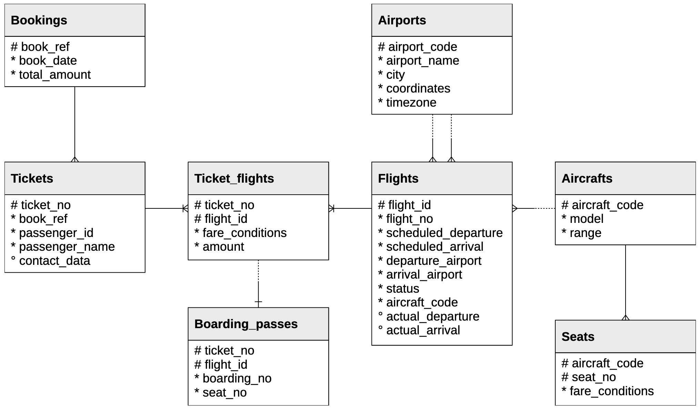
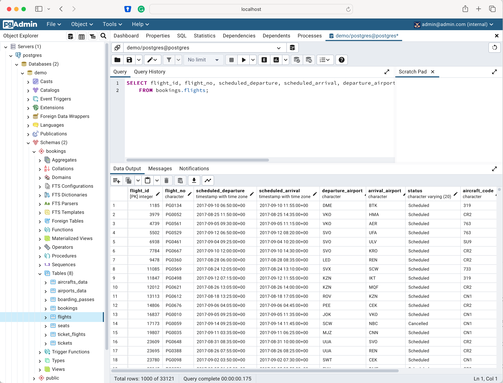

# Docker and databases hands-on exam 

This exam will check the *basic* knowledge of Docker and databases during the course Introduction to Data Science.

Your goal is to solve the following tasks:

## 1. Notebook Docker image creation

Implement file `python/Dockerfile` that will be based on the official Docker image `python:3.12-bookworm`. Within the Dockerfile implement the following:
* Set some default values for the environment variables *DATA_DIR* (default folder for jupyter notebooks) and *JUPYTER_PASSWORD* (Jupyter password).
* Install Python libraries *notebook (7.0.6)*, *pandas (2.1.3)* and *psycopg2 (2.9.9)*. Libraries should be defined in the requirements file in the *python* folder.
* Expose port *8888*.
* Run jupyter notebook at the end using the following parameters: `--ip=0.0.0.0 --port=8888 --no-browser --NotebookApp.token=${JUPYTER_PASSWORD} --allow-root --notebook-dir=${DATA_DIR}`.

Build image using a tag name `python`. Provide command for building the image from the root of the repository:

```bash
docker build -t python ./python
```

Do a test run of the built image as follows (update command if *pwd* or something else is not working in your environment):

```bash
docker run -it \
  --env DATA_DIR='/data' \
  --env JUPYTER_PASSWORD='Geslo.01' \
  --mount type=bind,source="$(pwd)"/data,target=/data \
  -p 7878:8888 \
  python
```

You should be able to access Jupyter notebook from Docker host via [http://localhost:7878](http://localhost:7878).

## 2. Docker services creation

## 2.1. Database Docker image

Implement file `postgres/Dockerfile` that will be based on the official Docker image `postgres:16.1-bookworm`. 

Build image using a tag name `postgres`. Provide command for building the image from the root of the repository:

```bash
docker build -t postgres ./postgres
```

We will use a [demonstration database of airline flights](https://postgrespro.com/community/demodb) in this project. Download the small database file (*[demo-small-en.zip](https://edu.postgrespro.com/demo-small-en.zip)*) and unzip file *demo-small-en-20170815.sql* into the *./scripts* folder. The schema of the database looks as follows:




Do a test run of the built image. Run a container in an interactive mode that will automatically execute SQL files in the *./scripts* folder:

```bash
docker run -it --rm \
  --mount type=bind,source="$(pwd)"/scripts,target=/docker-entrypoint-initdb.d \
  postgres
```
HINT: Add *IF EXISTS* to the DROP DATABASE statement in the sql file (line 17).

Copy output of the database executing the sql file on the first run:

```bash
/usr/local/bin/docker-entrypoint.sh: running /docker-entrypoint-initdb.d/demo-small-en-20170815.sql
SET
SET
SET
SET
SET
SET
SET
SET
DROP DATABASE
CREATE DATABASE
You are now connected to database "demo" as user "postgres".
SET
SET
SET
SET
SET
SET
SET
SET
CREATE SCHEMA
COMMENT
CREATE EXTENSION
COMMENT
SET
CREATE FUNCTION
CREATE FUNCTION
COMMENT
SET
SET
CREATE TABLE
COMMENT
COMMENT
COMMENT
COMMENT
CREATE VIEW
COMMENT
COMMENT
COMMENT
COMMENT
CREATE TABLE
COMMENT
COMMENT
COMMENT
COMMENT
COMMENT
COMMENT
CREATE VIEW
COMMENT
COMMENT
COMMENT
COMMENT
COMMENT
COMMENT
CREATE TABLE
COMMENT
COMMENT
COMMENT
COMMENT
COMMENT
CREATE TABLE
COMMENT
COMMENT
COMMENT
COMMENT
CREATE TABLE
COMMENT
COMMENT
COMMENT
COMMENT
COMMENT
COMMENT
COMMENT
COMMENT
COMMENT
COMMENT
COMMENT
CREATE SEQUENCE
ALTER SEQUENCE
CREATE VIEW
COMMENT
COMMENT
COMMENT
COMMENT
COMMENT
COMMENT
COMMENT
COMMENT
COMMENT
COMMENT
COMMENT
COMMENT
COMMENT
COMMENT
COMMENT
COMMENT
COMMENT
COMMENT
COMMENT
COMMENT
COMMENT
CREATE VIEW
COMMENT
COMMENT
COMMENT
COMMENT
COMMENT
COMMENT
COMMENT
COMMENT
COMMENT
COMMENT
COMMENT
CREATE TABLE
COMMENT
COMMENT
COMMENT
COMMENT
CREATE TABLE
COMMENT
COMMENT
COMMENT
COMMENT
COMMENT
CREATE TABLE
COMMENT
COMMENT
COMMENT
COMMENT
COMMENT
COMMENT
ALTER TABLE
COPY 9
COPY 104
COPY 579686
COPY 262788
COPY 33121
 setval 
--------
  33121
(1 row)

COPY 1339
COPY 1045726
COPY 366733
ALTER TABLE
ALTER TABLE
ALTER TABLE
ALTER TABLE
ALTER TABLE
ALTER TABLE
ALTER TABLE
ALTER TABLE
ALTER TABLE
ALTER TABLE
ALTER TABLE
ALTER TABLE
ALTER TABLE
ALTER TABLE
ALTER TABLE
ALTER TABLE
ALTER TABLE
ALTER TABLE
ALTER TABLE
ALTER DATABASE
ALTER DATABASE
```

## 2.2. Docker-compose script

Implement the following services:
* *python*
  * Map port 8888 to port 7878 on the host machine.
  * Set custom environment variables - *JUPYTER_DIR* to `/data` and *JUPYTER_PASSWORD* to `Geslo.01`.
  * Map folder `./data` to the folder `/data`.
* *postgres*
  * Set `postgres` user password to *Geslo.DataScience.2023*.
  * Map Postgres' data folder to a Docker volume named `postgres-data`.
* *pgadmin*:
  * Configure image *dpage/pgadmin4:7*
  * Make pgadmin web page available on host port 8080.

All three services should be in the same bridged network, called `ids-network`.

## 2.3. Build and run images

Implement script `build.sh` as indicated in the file. When you run that script, whole environment should be set up correctly.

Docker-compose script should be run in a detached mode.

Navigate to [http://localhost:8080](http://localhost:8080), login, add connection to the Postgres server and provide a screenshot with selected data from the bookings.flights table (Databases->demo->Schemas->bookings->Tables->flights -> right click -> Scripts->SELECT Script -> Run).



## 5. Database querying

When the containers are running, navigate to the jupyter notebook service ([http://localhost:8787](http://localhost:8787)) and open the *AirlineFlights_Demo* notebook.

In the notebook:

1. Implement all the missing code.
2. Run the notebook and save it together with the output. 

## 6. Copy data into an SQLite database

Implement script `./data/export-to-sqlite.py` and run it from your host machine using your *python* Docker image.

Docker command to run the script (suppose that all the containers from docker compose are running):

```
docker exec ids_docker_exam_2023_solution-python-1 python /data/export-to-sqlite.py
```

**Do not include** the `airlines-passengers.db` in the repository (add to the git ignore file)!

## 7. Double-check your work & submit

Go through the instructions again and make sure you implemented everything as requested. Save all the files, include them into git (double check if everything that is needed to run your repo is included) and push your work to the remote repository.

When your submission is graded, `build-and-run.sh` script will be executed. Then Jupyter notebook will be opened and the implemented cells should be visible along with results. Everything needs to be runnable from beginning to the end.
